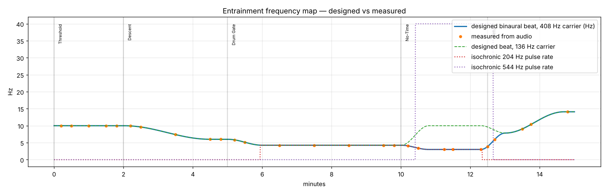
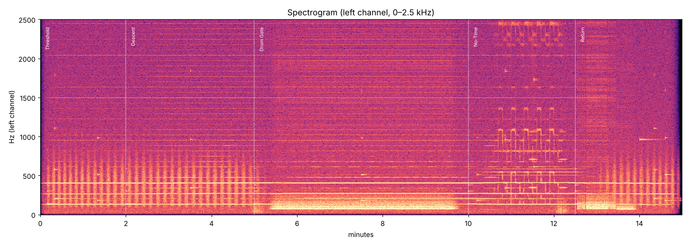

# Verification report — pineal_gateway_daily.wav

Duration: 15.00 min · Sample rate: 48000 Hz · Channels: 2

## Mastering

| Metric | Value |
|---|---|
| Integrated loudness (BS.1770-4) | -16.00 LUFS |
| True peak (4× oversampled) | -3.38 dBTP |
| Sample peak | -3.39 dBFS |
| Samples at/over 0 dBFS | 0 |
| DC offset L / R | -1.28e-12 / 4.02e-12 |

## Beat / pulse rate: designed vs measured

Each row is a 20-second window.  `beat` is |f_right − f_left| of the carrier peaks; `balance` is the interaural level difference of the carrier (should be ~0 dB).

| t (min) | layer | designed Hz | measured Hz | error Hz | L−R balance dB |
|---|---|---|---|---|---|
| 0.20 | binaural 408.30 Hz | 10.000 | 10.000 | +0.000 | +0.06 |
| 0.20 | binaural 272.20 Hz | 10.000 | 10.000 | +0.000 | -0.00 |
| 0.20 | binaural 136.10 Hz (bowl on this pitch ringing) | 10.000 | 10.001 | +0.001 | +0.11 |
| 0.50 | binaural 408.30 Hz | 10.000 | 10.000 | +0.000 | +0.04 |
| 0.50 | binaural 272.20 Hz | 10.000 | 10.000 | -0.000 | +0.03 |
| 0.50 | binaural 136.10 Hz (bowl on this pitch ringing) | 10.000 | 10.000 | -0.000 | +0.02 |
| 1.00 | binaural 408.30 Hz | 10.000 | 10.000 | -0.000 | -0.03 |
| 1.00 | binaural 272.20 Hz | 10.000 | 10.000 | +0.000 | -0.01 |
| 1.00 | binaural 136.10 Hz | 10.000 | 10.000 | +0.000 | +0.02 |
| 1.50 | binaural 408.30 Hz | 10.000 | 10.000 | -0.000 | +0.03 |
| 1.50 | binaural 272.20 Hz | 10.000 | 10.000 | -0.000 | -0.01 |
| 1.50 | binaural 136.10 Hz | 10.000 | 10.000 | +0.000 | +0.08 |
| 1.80 | binaural 408.30 Hz | 10.000 | 10.000 | -0.000 | +0.01 |
| 1.80 | binaural 272.20 Hz | 10.000 | 10.000 | +0.000 | +0.01 |
| 1.80 | binaural 136.10 Hz | 10.000 | 10.000 | -0.000 | +0.05 |
| 2.20 | binaural 408.30 Hz | 9.937 | 9.933 | -0.004 | -0.02 |
| 2.20 | binaural 272.20 Hz | 9.937 | 9.933 | -0.004 | +0.04 |
| 2.20 | binaural 136.10 Hz (bowl on this pitch ringing) | 9.937 | 9.933 | -0.004 | +0.00 |
| 2.50 | binaural 408.30 Hz | 9.618 | 9.616 | -0.002 | -0.02 |
| 2.50 | binaural 272.20 Hz | 9.618 | 9.616 | -0.002 | -0.01 |
| 2.50 | binaural 136.10 Hz (bowl on this pitch ringing) | 9.618 | 9.617 | -0.001 | +0.01 |
| 3.50 | binaural 408.30 Hz | 7.382 | 7.381 | -0.001 | +0.02 |
| 3.50 | binaural 272.20 Hz | 7.382 | 7.381 | -0.001 | -0.01 |
| 3.50 | binaural 136.10 Hz | 7.382 | 7.381 | -0.001 | +0.07 |
| 4.50 | binaural 408.30 Hz | 6.000 | 6.002 | +0.002 | -0.10 |
| 4.50 | binaural 272.20 Hz | 6.000 | 6.002 | +0.002 | +0.07 |
| 4.50 | binaural 136.10 Hz | 6.000 | 6.002 | +0.002 | -0.01 |
| 4.80 | binaural 408.30 Hz | 6.000 | 6.000 | -0.000 | -0.03 |
| 4.80 | binaural 272.20 Hz | 6.000 | 6.000 | -0.000 | +0.03 |
| 4.80 | binaural 136.10 Hz | 6.000 | 6.000 | +0.000 | -0.05 |
| 5.20 | binaural 408.30 Hz | 5.833 | 5.829 | -0.003 | +0.04 |
| 5.20 | binaural 272.20 Hz | 5.833 | 5.830 | -0.003 | -0.02 |
| 5.20 | binaural 136.10 Hz (bowl on this pitch ringing) | 5.833 | 5.830 | -0.003 | +0.02 |
| 5.50 | binaural 408.30 Hz | 5.125 | 5.125 | +0.000 | +0.01 |
| 5.50 | binaural 272.20 Hz | 5.125 | 5.124 | -0.001 | -0.00 |
| 5.50 | binaural 136.10 Hz (bowl on this pitch ringing) | 5.125 | 5.129 | +0.004 | -0.01 |
| 6.50 | binaural 408.30 Hz | 4.250 | 4.250 | -0.000 | +0.05 |
| 6.50 | binaural 272.20 Hz | 4.250 | 4.250 | +0.000 | -0.05 |
| 6.50 | binaural 136.10 Hz | 4.250 | 4.250 | +0.000 | +0.06 |
| 6.50 | isochronic 204.1 Hz | 4.250 | 4.246 | -0.004 | +0.00 |
| 7.50 | binaural 408.30 Hz | 4.250 | 4.250 | -0.000 | +0.05 |
| 7.50 | binaural 272.20 Hz | 4.250 | 4.250 | +0.000 | -0.04 |
| 7.50 | binaural 136.10 Hz | 4.250 | 4.250 | -0.000 | +0.08 |
| 7.50 | isochronic 204.1 Hz | 4.250 | 4.257 | +0.007 | +0.00 |
| 8.50 | binaural 408.30 Hz | 4.250 | 4.250 | +0.000 | +0.05 |
| 8.50 | binaural 272.20 Hz | 4.250 | 4.250 | +0.000 | -0.06 |
| 8.50 | binaural 136.10 Hz | 4.250 | 4.250 | -0.000 | +0.07 |
| 8.50 | isochronic 204.1 Hz | 4.250 | 4.246 | -0.004 | +0.00 |
| 9.50 | binaural 408.30 Hz | 4.250 | 4.250 | -0.000 | +0.05 |
| 9.50 | binaural 272.20 Hz | 4.250 | 4.250 | +0.000 | -0.07 |
| 9.50 | binaural 136.10 Hz | 4.250 | 4.251 | +0.001 | -0.09 |
| 9.50 | isochronic 204.1 Hz | 4.250 | 4.246 | -0.004 | +0.00 |
| 9.80 | binaural 408.30 Hz | 4.250 | 4.250 | -0.000 | +0.04 |
| 9.80 | binaural 272.20 Hz | 4.250 | 4.250 | +0.000 | -0.06 |
| 9.80 | binaural 136.10 Hz | 4.250 | 4.250 | -0.000 | +0.02 |
| 9.80 | isochronic 204.1 Hz | 4.250 | 4.246 | -0.004 | +0.00 |
| 10.20 | binaural 408.30 Hz | 4.067 | 4.065 | -0.002 | +0.01 |
| 10.20 | binaural 272.20 Hz | 4.067 | 4.065 | -0.002 | -0.02 |
| 10.20 | binaural 136.10 Hz (bowl on this pitch ringing) | 5.092 | 4.993 | -0.099 | +0.01 |
| 10.20 | isochronic 204.1 Hz | 4.067 | 4.108 | +0.041 | +0.00 |
| 10.50 | binaural 408.30 Hz | 3.386 | 3.382 | -0.004 | -0.07 |
| 10.50 | binaural 272.20 Hz | 3.386 | 3.381 | -0.004 | -0.03 |
| 10.50 | binaural 136.10 Hz (bowl on this pitch ringing) | 8.225 | 8.261 | +0.036 | -0.02 |
| 10.50 | isochronic 204.1 Hz | 3.386 | 3.387 | +0.002 | +0.00 |
| 10.50 | isochronic 544.4 Hz | 40.000 | 39.997 | -0.003 | +0.00 |
| 11.25 | binaural 408.30 Hz | 3.000 | 3.000 | +0.000 | -0.12 |
| 11.25 | binaural 272.20 Hz | 3.000 | 3.000 | -0.000 | -0.24 |
| 11.25 | binaural 136.10 Hz | 10.000 | 10.000 | -0.000 | -0.00 |
| 11.25 | isochronic 204.1 Hz | 3.000 | 2.998 | -0.002 | +0.00 |
| 11.25 | isochronic 544.4 Hz | 40.000 | 39.997 | -0.003 | +0.00 |
| 11.50 | binaural 408.30 Hz | 3.000 | 3.001 | +0.001 | +0.26 |
| 11.50 | binaural 272.20 Hz | 3.000 | 3.000 | -0.000 | +0.31 |
| 11.50 | binaural 136.10 Hz | 10.000 | 10.000 | +0.000 | -0.01 |
| 11.50 | isochronic 204.1 Hz | 3.000 | 2.998 | -0.002 | +0.00 |
| 11.50 | isochronic 544.4 Hz | 40.000 | 39.997 | -0.003 | +0.00 |
| 12.30 | binaural 408.30 Hz | 3.000 | 3.025 | +0.025 | -0.02 |
| 12.30 | binaural 272.20 Hz | 3.000 | 3.025 | +0.025 | +0.04 |
| 12.30 | binaural 136.10 Hz | 10.000 | 9.986 | -0.014 | -0.00 |
| 12.30 | isochronic 204.1 Hz | 3.000 | 3.159 | +0.159 | +0.00 |
| 12.30 | isochronic 544.4 Hz | 40.000 | 39.997 | -0.003 | +0.00 |
| 12.50 | binaural 408.30 Hz | 3.909 | 3.814 | -0.096 | +0.00 |
| 12.50 | binaural 272.20 Hz | 3.909 | 3.808 | -0.102 | +0.02 |
| 12.50 | binaural 136.10 Hz (bowl on this pitch ringing) | 9.591 | 9.639 | +0.048 | +0.02 |
| 12.50 | isochronic 544.4 Hz | 40.000 | 39.997 | -0.003 | +0.00 |
| 12.70 | binaural 408.30 Hz | 5.952 | 5.988 | +0.035 | -0.02 |
| 12.70 | binaural 272.20 Hz | 5.952 | 6.007 | +0.055 | +0.14 |
| 12.70 | binaural 136.10 Hz (bowl on this pitch ringing) | 8.674 | 8.636 | -0.037 | -0.04 |
| 13.50 | binaural 408.30 Hz | 9.076 | 9.064 | -0.011 | +0.02 |
| 13.50 | binaural 272.20 Hz | 9.076 | 9.063 | -0.013 | -0.05 |
| 13.50 | binaural 136.10 Hz | 9.076 | 9.079 | +0.003 | -0.08 |
| 13.75 | binaural 408.30 Hz | 10.389 | 10.379 | -0.010 | +0.02 |
| 13.75 | binaural 272.20 Hz | 10.389 | 10.381 | -0.008 | +0.01 |
| 13.75 | binaural 136.10 Hz | 10.389 | 10.375 | -0.014 | +0.27 |
| 14.80 | binaural 408.30 Hz | 14.100 | 14.100 | -0.000 | -0.03 |
| 14.80 | binaural 272.20 Hz | 14.100 | 14.099 | -0.001 | -0.05 |

Largest beat-rate error across all windows: **0.159 Hz** (a 20 s window has 0.05 Hz intrinsic resolution; ramping sections show the mean over the window).
Largest interaural level difference of a carrier in clean windows (steady beat, no bowl ringing on that pitch, no thunder event): **0.31 dB** over 34 windows (target < 0.5 dB). Rows marked 'bowl on this pitch ringing' are windows where a monaural bowl's doublet sits on the carrier's frequencies by design, so the balance figure there measures the bowl's pan, not the carrier; ramping windows smear the carrier line and are excluded from the summary for the same reason.

## Robustness to headphone spatialisers (iOS 'Spatialize Stereo' and similar)

A spatialiser feeds each channel partly into the opposite ear (simulated here: −7 dB, 0.45 ms, head-shadow low-pass). The binaural pair then also forms an acoustic (monaural) beat inside each ear. Measured pulse rate of the primary carrier's envelope in the left ear after that crosstalk:

| t (min) | designed Hz | measured in-ear beat Hz | error Hz |
|---|---|---|---|
| 0.20 | 10.000 | 10.002 | +0.002 |
| 1.80 | 10.000 | 10.002 | +0.002 |
| 4.50 | 6.000 | 5.997 | -0.003 |
| 6.50 | 4.250 | 4.246 | -0.004 |
| 9.80 | 4.250 | 4.246 | -0.004 |
| 11.50 | 3.000 | 2.998 | -0.002 |
| 13.50 | 9.076 | 9.041 | -0.035 |

Largest error under simulated spatialisation: **0.035 Hz** — the entrainment rate survives, though as a monaural rather than purely binaural beat. Turning Spatialize Stereo off is still recommended (see the listening guide).

## Figures

