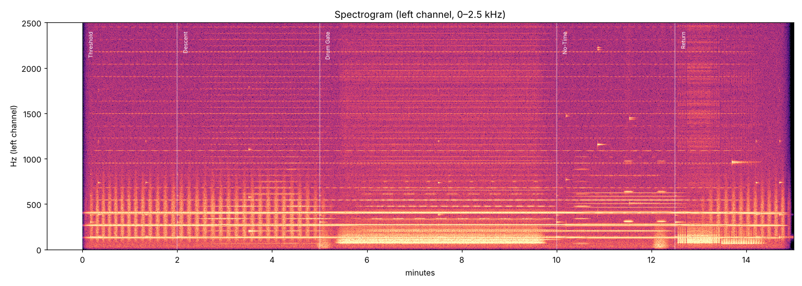

# Verification report — pineal_gateway_daily.mp3

Duration: 15.00 min · Sample rate: 48000 Hz · Channels: 2

## Mastering

| Metric | Value |
|---|---|
| Integrated loudness (BS.1770-4) | -16.00 LUFS |
| True peak (4× oversampled) | -3.30 dBTP |
| Sample peak | -3.31 dBFS |
| Samples at/over 0 dBFS | 0 |
| DC offset L / R | 7.20e-08 / -3.47e-07 |

## Beat / pulse rate: designed vs measured

Each row is a 20-second window.  `beat` is |f_right − f_left| of the carrier peaks; `balance` is the interaural level difference of the carrier (should be ~0 dB).

| t (min) | layer | designed Hz | measured Hz | error Hz | L−R balance dB |
|---|---|---|---|---|---|
| 0.20 | binaural 408.30 Hz | 10.000 | 10.000 | -0.000 | +0.01 |
| 0.20 | binaural 272.20 Hz | 10.000 | 10.000 | +0.000 | -0.01 |
| 0.20 | binaural 136.10 Hz | 10.000 | 10.001 | +0.001 | +0.11 |
| 0.50 | binaural 408.30 Hz | 10.000 | 10.000 | +0.000 | +0.03 |
| 0.50 | binaural 272.20 Hz | 10.000 | 10.000 | -0.000 | -0.02 |
| 0.50 | binaural 136.10 Hz | 10.000 | 10.000 | +0.000 | -0.01 |
| 1.00 | binaural 408.30 Hz | 10.000 | 10.000 | +0.000 | +0.04 |
| 1.00 | binaural 272.20 Hz | 10.000 | 10.000 | -0.000 | -0.02 |
| 1.00 | binaural 136.10 Hz | 10.000 | 10.000 | +0.000 | +0.04 |
| 1.50 | binaural 408.30 Hz | 10.000 | 10.000 | -0.000 | -0.03 |
| 1.50 | binaural 272.20 Hz | 10.000 | 10.000 | -0.000 | -0.00 |
| 1.50 | binaural 136.10 Hz | 10.000 | 10.000 | -0.000 | +0.01 |
| 1.80 | binaural 408.30 Hz | 10.000 | 10.000 | +0.000 | +0.01 |
| 1.80 | binaural 272.20 Hz | 10.000 | 10.000 | -0.000 | +0.01 |
| 1.80 | binaural 136.10 Hz | 10.000 | 10.000 | -0.000 | +0.08 |
| 2.20 | binaural 408.30 Hz | 9.937 | 9.933 | -0.004 | -0.03 |
| 2.20 | binaural 272.20 Hz | 9.937 | 9.933 | -0.004 | -0.02 |
| 2.20 | binaural 136.10 Hz | 9.937 | 9.933 | -0.004 | +0.03 |
| 2.50 | binaural 408.30 Hz | 9.618 | 9.617 | -0.001 | -0.00 |
| 2.50 | binaural 272.20 Hz | 9.618 | 9.617 | -0.002 | +0.01 |
| 2.50 | binaural 136.10 Hz | 9.618 | 9.616 | -0.002 | -0.07 |
| 3.50 | binaural 408.30 Hz | 7.382 | 7.380 | -0.002 | -0.07 |
| 3.50 | binaural 272.20 Hz | 7.382 | 7.381 | -0.001 | -0.03 |
| 3.50 | binaural 136.10 Hz | 7.382 | 7.382 | +0.000 | -0.01 |
| 4.50 | binaural 408.30 Hz | 6.000 | 6.002 | +0.002 | -0.10 |
| 4.50 | binaural 272.20 Hz | 6.000 | 6.002 | +0.002 | +0.07 |
| 4.50 | binaural 136.10 Hz | 6.000 | 6.002 | +0.002 | +0.02 |
| 4.80 | binaural 408.30 Hz | 6.000 | 6.000 | -0.000 | -0.02 |
| 4.80 | binaural 272.20 Hz | 6.000 | 6.000 | -0.000 | +0.05 |
| 4.80 | binaural 136.10 Hz | 6.000 | 6.000 | +0.000 | -0.04 |
| 5.20 | binaural 408.30 Hz | 5.833 | 5.829 | -0.004 | +0.04 |
| 5.20 | binaural 272.20 Hz | 5.833 | 5.829 | -0.003 | -0.02 |
| 5.20 | binaural 136.10 Hz | 5.833 | 5.830 | -0.003 | +0.00 |
| 5.50 | binaural 408.30 Hz | 5.125 | 5.125 | +0.000 | +0.01 |
| 5.50 | binaural 272.20 Hz | 5.125 | 5.125 | -0.000 | -0.01 |
| 5.50 | binaural 136.10 Hz | 5.125 | 5.128 | +0.003 | +0.00 |
| 6.50 | binaural 408.30 Hz | 4.250 | 4.250 | +0.000 | +0.06 |
| 6.50 | binaural 272.20 Hz | 4.250 | 4.250 | +0.000 | -0.06 |
| 6.50 | binaural 136.10 Hz | 4.250 | 4.250 | +0.000 | +0.07 |
| 6.50 | isochronic 204.1 Hz | 4.250 | 4.246 | -0.004 | +0.00 |
| 7.50 | binaural 408.30 Hz | 4.250 | 4.250 | -0.000 | +0.06 |
| 7.50 | binaural 272.20 Hz | 4.250 | 4.250 | -0.000 | -0.04 |
| 7.50 | binaural 136.10 Hz | 4.250 | 4.252 | +0.002 | -0.75 |
| 7.50 | isochronic 204.1 Hz | 4.250 | 4.246 | -0.004 | +0.00 |
| 8.50 | binaural 408.30 Hz | 4.250 | 4.250 | +0.000 | +0.07 |
| 8.50 | binaural 272.20 Hz | 4.250 | 4.250 | +0.000 | -0.07 |
| 8.50 | binaural 136.10 Hz | 4.250 | 4.250 | -0.000 | +0.07 |
| 8.50 | isochronic 204.1 Hz | 4.250 | 4.246 | -0.004 | +0.00 |
| 9.50 | binaural 408.30 Hz | 4.250 | 4.250 | -0.000 | +0.07 |
| 9.50 | binaural 272.20 Hz | 4.250 | 4.250 | -0.000 | -0.07 |
| 9.50 | binaural 136.10 Hz | 4.250 | 4.251 | +0.001 | -0.08 |
| 9.50 | isochronic 204.1 Hz | 4.250 | 4.246 | -0.004 | +0.00 |
| 9.80 | binaural 408.30 Hz | 4.250 | 4.250 | +0.000 | +0.06 |
| 9.80 | binaural 272.20 Hz | 4.250 | 4.250 | +0.000 | -0.07 |
| 9.80 | binaural 136.10 Hz | 4.250 | 4.250 | -0.000 | +0.01 |
| 9.80 | isochronic 204.1 Hz | 4.250 | 4.246 | -0.004 | +0.00 |
| 10.20 | binaural 408.30 Hz | 4.067 | 4.065 | -0.002 | +0.02 |
| 10.20 | binaural 272.20 Hz | 4.067 | 4.106 | +0.039 | +3.33 |
| 10.20 | binaural 136.10 Hz | 5.092 | 4.996 | -0.096 | -0.01 |
| 10.20 | isochronic 204.1 Hz | 4.067 | 4.086 | +0.019 | +0.00 |
| 10.50 | binaural 408.30 Hz | 3.386 | 3.383 | -0.003 | -0.00 |
| 10.50 | binaural 272.20 Hz | 3.386 | 3.382 | -0.004 | -0.03 |
| 10.50 | binaural 136.10 Hz | 8.225 | 8.290 | +0.065 | +0.03 |
| 10.50 | isochronic 204.1 Hz | 3.386 | 3.387 | +0.002 | +0.00 |
| 10.50 | isochronic 544.4 Hz | 40.000 | 39.997 | -0.003 | +0.00 |
| 11.25 | binaural 408.30 Hz | 3.000 | 3.001 | +0.001 | +0.11 |
| 11.25 | binaural 272.20 Hz | 3.000 | 3.001 | +0.001 | +0.07 |
| 11.25 | binaural 136.10 Hz | 10.000 | 10.000 | +0.000 | +0.04 |
| 11.25 | isochronic 204.1 Hz | 3.000 | 2.998 | -0.002 | +0.00 |
| 11.25 | isochronic 544.4 Hz | 40.000 | 39.997 | -0.003 | +0.00 |
| 11.50 | binaural 408.30 Hz | 3.000 | 3.000 | +0.000 | -0.02 |
| 11.50 | binaural 272.20 Hz | 3.000 | 3.001 | +0.001 | -0.06 |
| 11.50 | binaural 136.10 Hz | 10.000 | 10.000 | -0.000 | +0.05 |
| 11.50 | isochronic 204.1 Hz | 3.000 | 2.998 | -0.002 | +0.00 |
| 11.50 | isochronic 544.4 Hz | 40.000 | 39.997 | -0.003 | +0.00 |
| 12.30 | binaural 408.30 Hz | 3.000 | 3.019 | +0.019 | +0.02 |
| 12.30 | binaural 272.20 Hz | 3.000 | 3.019 | +0.019 | -0.01 |
| 12.30 | binaural 136.10 Hz | 10.000 | 9.991 | -0.009 | +0.02 |
| 12.30 | isochronic 204.1 Hz | 3.000 | 3.010 | +0.010 | +0.00 |
| 12.30 | isochronic 544.4 Hz | 40.000 | 39.997 | -0.003 | +0.00 |
| 12.50 | binaural 408.30 Hz | 3.565 | 3.503 | -0.062 | +0.00 |
| 12.50 | binaural 272.20 Hz | 3.565 | 3.504 | -0.061 | -0.00 |
| 12.50 | binaural 136.10 Hz | 9.746 | 9.758 | +0.012 | +0.09 |
| 12.50 | isochronic 544.4 Hz | 40.000 | 39.997 | -0.003 | +0.00 |
| 12.70 | binaural 408.30 Hz | 4.996 | 4.978 | -0.018 | -0.00 |
| 12.70 | binaural 272.20 Hz | 4.996 | 4.988 | -0.007 | -0.02 |
| 12.70 | binaural 136.10 Hz | 9.103 | 9.100 | -0.003 | -0.14 |
| 13.50 | binaural 408.30 Hz | 8.514 | 8.483 | -0.031 | -0.00 |
| 13.50 | binaural 272.20 Hz | 8.514 | 8.492 | -0.022 | +0.03 |
| 13.50 | binaural 136.10 Hz | 8.514 | 8.483 | -0.031 | +0.20 |
| 13.75 | binaural 408.30 Hz | 9.930 | 9.922 | -0.007 | +0.05 |
| 13.75 | binaural 272.20 Hz | 9.930 | 9.919 | -0.011 | +0.01 |
| 13.75 | binaural 136.10 Hz | 9.930 | 9.946 | +0.017 | +0.53 |
| 14.80 | binaural 408.30 Hz | 14.100 | 14.101 | +0.001 | -0.07 |
| 14.80 | binaural 272.20 Hz | 14.100 | 14.100 | +0.000 | +0.11 |

Largest beat-rate error across all windows: **0.096 Hz** (a 20 s window has 0.05 Hz intrinsic resolution; ramping sections show the mean over the window).

## Figures

