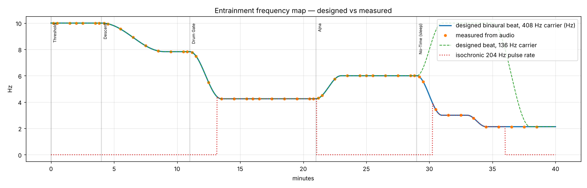
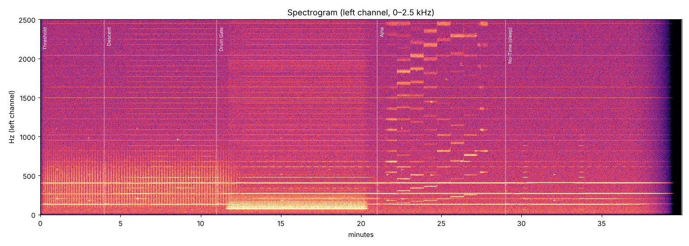

# Verification report — pineal_gateway_sleep.wav

Duration: 40.00 min · Sample rate: 48000 Hz · Channels: 2

## Mastering

| Metric | Value |
|---|---|
| Integrated loudness (BS.1770-4) | -16.00 LUFS |
| True peak (4× oversampled) | -3.50 dBTP |
| Sample peak | -3.51 dBFS |
| Samples at/over 0 dBFS | 0 |
| DC offset L / R | 1.60e-12 / 9.69e-13 |

## Beat / pulse rate: designed vs measured

Each row is a 20-second window.  `beat` is |f_right − f_left| of the carrier peaks; `balance` is the interaural level difference of the carrier (should be ~0 dB).

| t (min) | layer | designed Hz | measured Hz | error Hz | L−R balance dB |
|---|---|---|---|---|---|
| 0.20 | binaural 408.30 Hz | 10.000 | 10.000 | +0.000 | +0.06 |
| 0.20 | binaural 272.20 Hz | 10.000 | 10.000 | +0.000 | +0.01 |
| 0.20 | binaural 136.10 Hz (bowl on this pitch ringing) | 10.000 | 10.000 | -0.000 | +0.36 |
| 0.50 | binaural 408.30 Hz | 10.000 | 10.000 | +0.000 | +0.04 |
| 0.50 | binaural 272.20 Hz | 10.000 | 10.000 | -0.000 | +0.02 |
| 0.50 | binaural 136.10 Hz (bowl on this pitch ringing) | 10.000 | 10.000 | -0.000 | +0.01 |
| 1.50 | binaural 408.30 Hz | 10.000 | 10.000 | +0.000 | +0.04 |
| 1.50 | binaural 272.20 Hz | 10.000 | 10.000 | -0.000 | -0.01 |
| 1.50 | binaural 136.10 Hz | 10.000 | 10.000 | +0.000 | +0.05 |
| 2.00 | binaural 408.30 Hz | 10.000 | 10.000 | +0.000 | +0.04 |
| 2.00 | binaural 272.20 Hz | 10.000 | 10.000 | -0.000 | -0.08 |
| 2.00 | binaural 136.10 Hz | 10.000 | 10.000 | +0.000 | +0.05 |
| 2.50 | binaural 408.30 Hz | 10.000 | 10.000 | +0.000 | +0.02 |
| 2.50 | binaural 272.20 Hz | 10.000 | 10.000 | +0.000 | +0.00 |
| 2.50 | binaural 136.10 Hz | 10.000 | 10.000 | -0.000 | -0.02 |
| 3.50 | binaural 408.30 Hz | 10.000 | 10.000 | -0.000 | -0.02 |
| 3.50 | binaural 272.20 Hz | 10.000 | 10.000 | -0.000 | -0.02 |
| 3.50 | binaural 136.10 Hz | 10.000 | 10.000 | +0.000 | +0.07 |
| 3.80 | binaural 408.30 Hz | 10.000 | 10.000 | -0.000 | +0.02 |
| 3.80 | binaural 272.20 Hz | 10.000 | 10.000 | -0.000 | +0.01 |
| 3.80 | binaural 136.10 Hz | 10.000 | 9.999 | -0.001 | -0.01 |
| 4.20 | binaural 408.30 Hz | 9.991 | 9.991 | -0.001 | +0.02 |
| 4.20 | binaural 272.20 Hz | 9.991 | 9.991 | -0.001 | -0.00 |
| 4.20 | binaural 136.10 Hz (bowl on this pitch ringing) | 9.991 | 9.991 | -0.001 | -0.01 |
| 4.50 | binaural 408.30 Hz | 9.947 | 9.946 | -0.001 | -0.00 |
| 4.50 | binaural 272.20 Hz | 9.947 | 9.946 | -0.001 | -0.02 |
| 4.50 | binaural 136.10 Hz (bowl on this pitch ringing) | 9.947 | 9.947 | -0.000 | +0.04 |
| 5.50 | binaural 408.30 Hz | 9.553 | 9.552 | -0.000 | -0.02 |
| 5.50 | binaural 272.20 Hz | 9.553 | 9.553 | -0.000 | +0.04 |
| 5.50 | binaural 136.10 Hz | 9.553 | 9.552 | -0.000 | +0.02 |
| 6.50 | binaural 408.30 Hz | 8.915 | 8.915 | -0.000 | -0.00 |
| 6.50 | binaural 272.20 Hz | 8.915 | 8.915 | -0.000 | -0.01 |
| 6.50 | binaural 136.10 Hz | 8.915 | 8.916 | +0.001 | +0.03 |
| 7.50 | binaural 408.30 Hz | 8.277 | 8.277 | +0.000 | +0.00 |
| 7.50 | binaural 272.20 Hz | 8.277 | 8.277 | +0.000 | -0.04 |
| 7.50 | binaural 136.10 Hz | 8.277 | 8.278 | +0.001 | -0.03 |
| 8.50 | binaural 408.30 Hz | 7.883 | 7.884 | +0.000 | -0.00 |
| 8.50 | binaural 272.20 Hz | 7.883 | 7.883 | +0.000 | +0.05 |
| 8.50 | binaural 136.10 Hz | 7.883 | 7.883 | +0.000 | +0.04 |
| 9.50 | binaural 408.30 Hz | 7.830 | 7.830 | -0.000 | +0.01 |
| 9.50 | binaural 272.20 Hz | 7.830 | 7.830 | -0.000 | +0.03 |
| 9.50 | binaural 136.10 Hz | 7.830 | 7.830 | -0.000 | -0.05 |
| 10.50 | binaural 408.30 Hz | 7.830 | 7.830 | -0.000 | -0.02 |
| 10.50 | binaural 272.20 Hz | 7.830 | 7.830 | +0.000 | +0.03 |
| 10.50 | binaural 136.10 Hz | 7.830 | 7.830 | +0.000 | -0.01 |
| 10.80 | binaural 408.30 Hz | 7.830 | 7.830 | -0.000 | -0.05 |
| 10.80 | binaural 272.20 Hz | 7.830 | 7.830 | -0.000 | +0.01 |
| 10.80 | binaural 136.10 Hz | 7.830 | 7.830 | -0.000 | -0.04 |
| 11.20 | binaural 408.30 Hz | 7.774 | 7.770 | -0.004 | +0.02 |
| 11.20 | binaural 272.20 Hz | 7.774 | 7.770 | -0.004 | +0.00 |
| 11.20 | binaural 136.10 Hz (bowl on this pitch ringing) | 7.774 | 7.770 | -0.004 | -0.01 |
| 11.50 | binaural 408.30 Hz | 7.488 | 7.486 | -0.002 | -0.01 |
| 11.50 | binaural 272.20 Hz | 7.488 | 7.486 | -0.002 | +0.02 |
| 11.50 | binaural 136.10 Hz (bowl on this pitch ringing) | 7.488 | 7.486 | -0.002 | -0.02 |
| 12.50 | binaural 408.30 Hz | 5.487 | 5.486 | -0.001 | +0.02 |
| 12.50 | binaural 272.20 Hz | 5.487 | 5.486 | -0.001 | -0.02 |
| 12.50 | binaural 136.10 Hz | 5.487 | 5.487 | -0.000 | -0.15 |
| 13.50 | binaural 408.30 Hz | 4.250 | 4.252 | +0.002 | +0.04 |
| 13.50 | binaural 272.20 Hz | 4.250 | 4.252 | +0.002 | -0.03 |
| 13.50 | binaural 136.10 Hz | 4.250 | 4.252 | +0.002 | +0.16 |
| 13.50 | isochronic 204.1 Hz | 4.250 | 4.234 | -0.016 | +0.00 |
| 14.50 | binaural 408.30 Hz | 4.250 | 4.250 | -0.000 | +0.05 |
| 14.50 | binaural 272.20 Hz | 4.250 | 4.250 | -0.000 | -0.07 |
| 14.50 | binaural 136.10 Hz | 4.250 | 4.250 | +0.000 | +0.03 |
| 14.50 | isochronic 204.1 Hz | 4.250 | 4.257 | +0.007 | +0.00 |
| 15.50 | binaural 408.30 Hz | 4.250 | 4.250 | -0.000 | +0.05 |
| 15.50 | binaural 272.20 Hz | 4.250 | 4.250 | -0.000 | -0.04 |
| 15.50 | binaural 136.10 Hz | 4.250 | 4.250 | +0.000 | +0.01 |
| 15.50 | isochronic 204.1 Hz | 4.250 | 4.257 | +0.007 | +0.00 |
| 16.00 | binaural 408.30 Hz | 4.250 | 4.250 | +0.000 | +0.05 |
| 16.00 | binaural 272.20 Hz | 4.250 | 4.250 | +0.000 | -0.05 |
| 16.00 | binaural 136.10 Hz | 4.250 | 4.250 | +0.000 | +0.22 |
| 16.00 | isochronic 204.1 Hz | 4.250 | 4.246 | -0.004 | +0.00 |
| 16.50 | binaural 408.30 Hz | 4.250 | 4.250 | -0.000 | +0.05 |
| 16.50 | binaural 272.20 Hz | 4.250 | 4.250 | -0.000 | -0.05 |
| 16.50 | binaural 136.10 Hz | 4.250 | 4.251 | +0.001 | -0.02 |
| 16.50 | isochronic 204.1 Hz | 4.250 | 4.246 | -0.004 | +0.00 |
| 17.50 | binaural 408.30 Hz | 4.250 | 4.250 | +0.000 | +0.05 |
| 17.50 | binaural 272.20 Hz | 4.250 | 4.250 | +0.000 | -0.07 |
| 17.50 | binaural 136.10 Hz | 4.250 | 4.250 | +0.000 | +0.07 |
| 17.50 | isochronic 204.1 Hz | 4.250 | 4.246 | -0.004 | +0.00 |
| 18.50 | binaural 408.30 Hz | 4.250 | 4.250 | -0.000 | +0.04 |
| 18.50 | binaural 272.20 Hz | 4.250 | 4.250 | -0.000 | -0.05 |
| 18.50 | binaural 136.10 Hz | 4.250 | 4.250 | -0.000 | -0.01 |
| 18.50 | isochronic 204.1 Hz | 4.250 | 4.246 | -0.004 | +0.00 |
| 19.50 | binaural 408.30 Hz | 4.250 | 4.250 | -0.000 | +0.05 |
| 19.50 | binaural 272.20 Hz | 4.250 | 4.250 | -0.000 | -0.05 |
| 19.50 | binaural 136.10 Hz | 4.250 | 4.250 | +0.000 | +0.04 |
| 19.50 | isochronic 204.1 Hz | 4.250 | 4.246 | -0.004 | +0.00 |
| 20.50 | binaural 408.30 Hz | 4.250 | 4.250 | -0.000 | +0.05 |
| 20.50 | binaural 272.20 Hz | 4.250 | 4.250 | +0.000 | -0.05 |
| 20.50 | binaural 136.10 Hz | 4.250 | 4.250 | -0.000 | +0.00 |
| 20.50 | isochronic 204.1 Hz | 4.250 | 4.246 | -0.004 | +0.00 |
| 20.80 | binaural 408.30 Hz | 4.250 | 4.250 | -0.000 | +0.05 |
| 20.80 | binaural 272.20 Hz | 4.250 | 4.250 | +0.000 | -0.06 |
| 20.80 | binaural 136.10 Hz | 4.250 | 4.250 | +0.000 | +0.02 |
| 20.80 | isochronic 204.1 Hz | 4.250 | 4.246 | -0.004 | +0.00 |
| 21.20 | binaural 408.30 Hz | 4.293 | 4.296 | +0.003 | +0.04 |
| 21.20 | binaural 272.20 Hz | 4.293 | 4.296 | +0.003 | -0.06 |
| 21.20 | binaural 136.10 Hz (bowl on this pitch ringing) | 4.293 | 4.297 | +0.004 | -0.03 |
| 21.50 | binaural 408.30 Hz | 4.506 | 4.508 | +0.002 | +0.00 |
| 21.50 | binaural 272.20 Hz | 4.506 | 4.508 | +0.002 | -0.02 |
| 21.50 | binaural 136.10 Hz (bowl on this pitch ringing) | 4.506 | 4.508 | +0.002 | +0.10 |
| 22.50 | binaural 408.30 Hz | 5.744 | 5.742 | -0.002 | +0.02 |
| 22.50 | binaural 272.20 Hz | 5.744 | 5.742 | -0.002 | -0.03 |
| 22.50 | binaural 136.10 Hz | 5.744 | 5.742 | -0.002 | +0.03 |
| 23.50 | binaural 408.30 Hz | 6.000 | 6.000 | +0.000 | -0.02 |
| 23.50 | binaural 272.20 Hz | 6.000 | 6.000 | +0.000 | +0.01 |
| 23.50 | binaural 136.10 Hz | 6.000 | 6.000 | -0.000 | -0.04 |
| 24.50 | binaural 408.30 Hz | 6.000 | 6.000 | +0.000 | -0.03 |
| 24.50 | binaural 272.20 Hz | 6.000 | 6.000 | -0.000 | +0.03 |
| 24.50 | binaural 136.10 Hz | 6.000 | 6.000 | +0.000 | -0.05 |
| 25.00 | binaural 408.30 Hz | 6.000 | 6.000 | +0.000 | +0.19 |
| 25.00 | binaural 272.20 Hz | 6.000 | 6.000 | +0.000 | +0.02 |
| 25.00 | binaural 136.10 Hz | 6.000 | 6.000 | -0.000 | -0.03 |
| 25.50 | binaural 408.30 Hz | 6.000 | 6.001 | +0.001 | +0.17 |
| 25.50 | binaural 272.20 Hz | 6.000 | 6.000 | +0.000 | +0.01 |
| 25.50 | binaural 136.10 Hz | 6.000 | 6.000 | -0.000 | -0.04 |
| 26.50 | binaural 408.30 Hz | 6.000 | 6.000 | +0.000 | -0.03 |
| 26.50 | binaural 272.20 Hz | 6.000 | 6.000 | -0.000 | +0.02 |
| 26.50 | binaural 136.10 Hz | 6.000 | 6.000 | -0.000 | -0.03 |
| 27.50 | binaural 408.30 Hz | 6.000 | 6.000 | -0.000 | -0.03 |
| 27.50 | binaural 272.20 Hz | 6.000 | 6.000 | -0.000 | -0.04 |
| 27.50 | binaural 136.10 Hz | 6.000 | 6.000 | +0.000 | -0.02 |
| 28.50 | binaural 408.30 Hz | 6.000 | 6.000 | +0.000 | -0.03 |
| 28.50 | binaural 272.20 Hz | 6.000 | 6.000 | -0.000 | +0.02 |
| 28.50 | binaural 136.10 Hz | 6.000 | 6.000 | -0.000 | -0.03 |
| 28.80 | binaural 408.30 Hz | 6.000 | 6.000 | -0.000 | -0.02 |
| 28.80 | binaural 272.20 Hz | 6.000 | 6.000 | +0.000 | +0.02 |
| 28.80 | binaural 136.10 Hz | 6.000 | 6.000 | +0.000 | -0.04 |
| 29.20 | binaural 408.30 Hz | 5.927 | 5.922 | -0.004 | +0.04 |
| 29.20 | binaural 272.20 Hz | 5.927 | 5.922 | -0.004 | -0.03 |
| 29.20 | binaural 136.10 Hz (bowl on this pitch ringing) | 6.098 | 6.103 | +0.005 | -0.00 |
| 29.50 | binaural 408.30 Hz | 5.561 | 5.560 | -0.001 | +0.00 |
| 29.50 | binaural 272.20 Hz | 5.561 | 5.560 | -0.001 | +0.01 |
| 29.50 | binaural 136.10 Hz (bowl on this pitch ringing) | 6.586 | 6.582 | -0.003 | +0.01 |
| 30.50 | binaural 408.30 Hz | 3.439 | 3.440 | +0.001 | -0.03 |
| 30.50 | binaural 272.20 Hz | 3.439 | 3.440 | +0.001 | +0.04 |
| 30.50 | binaural 136.10 Hz | 9.414 | 9.417 | +0.003 | +0.00 |
| 30.50 | isochronic 204.1 Hz | 3.439 | 3.342 | -0.098 | +0.00 |
| 31.50 | binaural 408.30 Hz | 3.000 | 3.000 | +0.000 | -0.01 |
| 31.50 | binaural 272.20 Hz | 3.000 | 3.000 | +0.000 | +0.01 |
| 31.50 | binaural 136.10 Hz | 10.000 | 10.000 | -0.000 | +0.04 |
| 31.50 | isochronic 204.1 Hz | 3.000 | 2.998 | -0.002 | +0.00 |
| 32.50 | binaural 408.30 Hz | 3.000 | 3.000 | +0.000 | -0.02 |
| 32.50 | binaural 272.20 Hz | 3.000 | 3.000 | -0.000 | +0.01 |
| 32.50 | binaural 136.10 Hz | 10.000 | 10.000 | +0.000 | +0.04 |
| 32.50 | isochronic 204.1 Hz | 3.000 | 2.998 | -0.002 | +0.00 |
| 33.50 | binaural 408.30 Hz | 2.783 | 2.781 | -0.001 | +0.02 |
| 33.50 | binaural 272.20 Hz | 2.783 | 2.781 | -0.001 | +0.02 |
| 33.50 | binaural 136.10 Hz | 10.000 | 10.000 | +0.000 | +0.01 |
| 33.50 | isochronic 204.1 Hz | 2.783 | 2.815 | +0.033 | +0.00 |
| 34.50 | binaural 408.30 Hz | 2.130 | 2.131 | +0.001 | -0.02 |
| 34.50 | binaural 272.20 Hz | 2.130 | 2.131 | +0.001 | +0.02 |
| 34.50 | binaural 136.10 Hz | 10.000 | 10.000 | +0.000 | +0.03 |
| 34.50 | isochronic 204.1 Hz | 2.130 | 2.129 | -0.001 | +0.00 |
| 35.50 | binaural 408.30 Hz | 2.130 | 2.130 | +0.000 | -0.01 |
| 35.50 | binaural 272.20 Hz | 2.130 | 2.130 | +0.000 | +0.02 |
| 35.50 | binaural 136.10 Hz | 9.473 | 9.475 | +0.002 | +0.01 |
| 35.50 | isochronic 204.1 Hz | 2.130 | 2.129 | -0.001 | +0.00 |
| 36.50 | binaural 408.30 Hz | 2.130 | 2.130 | +0.000 | -0.02 |
| 36.50 | binaural 272.20 Hz | 2.130 | 2.130 | +0.000 | +0.02 |
| 36.50 | binaural 136.10 Hz | 6.065 | 6.064 | -0.001 | -0.02 |
| 37.50 | binaural 408.30 Hz | 2.130 | 2.130 | +0.000 | -0.01 |
| 37.50 | binaural 272.20 Hz | 2.130 | 2.130 | -0.000 | +0.02 |
| 37.50 | binaural 136.10 Hz | 2.657 | 2.660 | +0.003 | -0.02 |
| 38.50 | binaural 408.30 Hz | 2.130 | 2.130 | +0.000 | -0.01 |
| 38.50 | binaural 272.20 Hz | 2.130 | 2.130 | +0.000 | +0.01 |
| 38.50 | binaural 136.10 Hz | 2.130 | 2.130 | +0.000 | -0.03 |

Largest beat-rate error across all windows: **0.098 Hz** (a 20 s window has 0.05 Hz intrinsic resolution; ramping sections show the mean over the window).
Largest interaural level difference of a carrier in clean windows (steady beat, no bowl ringing on that pitch, no thunder event): **0.22 dB** over 96 windows (target < 0.5 dB). Rows marked 'bowl on this pitch ringing' are windows where a monaural bowl's doublet sits on the carrier's frequencies by design, so the balance figure there measures the bowl's pan, not the carrier; ramping windows smear the carrier line and are excluded from the summary for the same reason.

## Robustness to headphone spatialisers (iOS 'Spatialize Stereo' and similar)

A spatialiser feeds each channel partly into the opposite ear (simulated here: −7 dB, 0.45 ms, head-shadow low-pass). The binaural pair then also forms an acoustic (monaural) beat inside each ear. Measured pulse rate of the primary carrier's envelope in the left ear after that crosstalk:

| t (min) | designed Hz | measured in-ear beat Hz | error Hz |
|---|---|---|---|
| 0.20 | 10.000 | 10.002 | +0.002 |
| 2.50 | 10.000 | 10.002 | +0.002 |
| 4.50 | 9.947 | 9.945 | -0.002 |
| 8.50 | 7.883 | 7.885 | +0.002 |
| 11.20 | 7.774 | 7.771 | -0.003 |
| 14.50 | 4.250 | 4.246 | -0.004 |
| 17.50 | 4.250 | 4.246 | -0.004 |
| 20.80 | 4.250 | 4.246 | -0.004 |
| 23.50 | 6.000 | 5.997 | -0.003 |
| 26.50 | 6.000 | 5.997 | -0.003 |
| 29.20 | 5.927 | 5.928 | +0.001 |
| 32.50 | 3.000 | 2.998 | -0.002 |
| 36.50 | 2.130 | 2.129 | -0.001 |

Largest error under simulated spatialisation: **0.004 Hz** — the entrainment rate survives, though as a monaural rather than purely binaural beat. Turning Spatialize Stereo off is still recommended (see the listening guide).

## Figures

